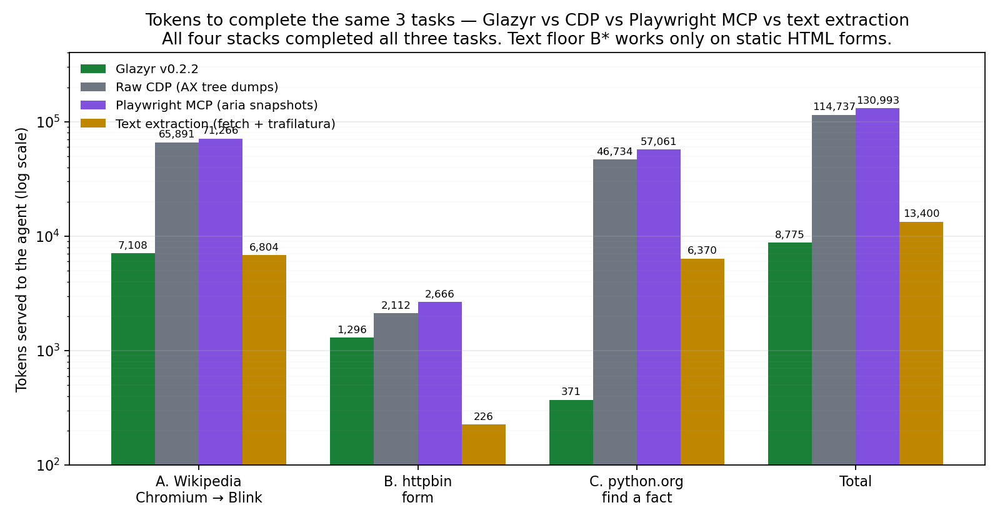

# Glazyr MCP

Zero-copy browser perception infrastructure for AI agents.

**npm:** [@glazyr/mcp](https://www.npmjs.com/package/@glazyr/mcp) · **Site:** [glazyr.com](https://glazyr.com) · **Benchmark:** [report and drivers](benchmarks/comparison-2026-11-21.md)

Glazyr is a patched Chromium whose page-content producer writes the page's
semantic tree directly into shared memory. An external process reads that
state in microseconds — no CDP round-trip, no accessibility-tree dump, no
screenshot guessing. The MCP bridge curates the tree for token cost and
exposes it to agents as nine tools.

## How it works

Everything runs on **your** machine — the same machine your agent runs on:

1. Your MCP client starts the Glazyr server (`npx @glazyr/mcp`). On first
   run it downloads the browser bundle (~106 MB) from this repo's Releases
   and sets up an isolated Python environment under `~/.glazyr`.
2. The server launches your local copy of the Glazyr browser (patched
   Chromium 158) and manages it for the session.
3. On page load, the browser itself extracts the page's semantic tree and
   writes it into a shared-memory region. The bridge reads it from there
   in ~1–50µs and curates it for token cost: summary-first navigation,
   find/subtree zoom, sibling collapse, unchanged-state stubs.
4. Actions (click, type, scroll) go back to the browser over CDP,
   addressed by node id with layout geometry from the browser itself —
   no coordinate guessing.

There is no hosted service in the loop: no account, no API key, no
telemetry, nothing phones home. Your agent never touches the publisher's
computers, and the publisher never touches yours — each install is an
independent local browser, like Playwright's, just built for agents
instead of test scripts.

## Benchmark

Measured on identical tasks, same machine (Nov 21, 2026; every token
served to the agent counted with tiktoken `cl100k_base`):

| Flow | Glazyr | Raw CDP | Playwright MCP | Text extraction |
| --- | ---: | ---: | ---: | ---: |
| Wikipedia → Blink | 7,108 | 65,891 | 71,266 | 6,804 |
| httpbin form | 1,296 | 2,112 | 2,666 | 226* |
| python.org fact | 371 | 46,734 | 57,061 | 6,370 |
| **Total** | **8,775** | **114,737** | **130,993** | **13,400** |

13× fewer tokens than raw CDP, 15× fewer than Playwright MCP. Honest
caveat: text extraction wins pure article reading by a hair — it cannot
click, type, or act on JavaScript-driven pages. Glazyr can.



Full report, method notes, and the driver scripts for all four stacks:
[benchmarks/comparison-2026-11-21.md](benchmarks/comparison-2026-11-21.md)

## Install

Add to your MCP client config (Claude Code, Claude Desktop, Cursor,
Antigravity, any MCP client):

```json
{
  "mcpServers": {
    "glazyr": {
      "command": "npx",
      "args": ["-y", "@glazyr/mcp"]
    }
  }
}
```

First run downloads the browser bundle (~106 MB) and creates a Python
environment under `~/.glazyr` — expect a minute or two. After that,
startup is silent and the browser launches and manages itself.

**Windows:** run Glazyr inside WSL2 and point your client at it:

```json
{
  "mcpServers": {
    "glazyr": {
      "command": "wsl.exe",
      "args": ["-d", "Ubuntu", "-u", "root", "--", "npx", "-y", "@glazyr/mcp"]
    }
  }
}
```

(adjust the distro name and user to yours).

## Requirements

- Linux x64, or Windows with WSL2
- Node.js 18+
- Python 3.10+ (the bridge runs in an isolated venv it creates itself)
- ~450 MB disk for the browser bundle

macOS builds do not exist yet.

## The nine tools

| Tool | What it does |
| --- | --- |
| `glazyr_status` | Browser state, process, shared-memory region status |
| `glazyr_navigate` | Navigate; returns a summary map first (245 tokens on Wikipedia) |
| `glazyr_peek` | Filtered page state (~13–14K tokens on a large article) |
| `glazyr_peek_raw` | Unfiltered state — the escalation path |
| `glazyr_peek_subtree` | Zoom into one container or element subtree |
| `glazyr_find` | Search page structure for matching nodes or text |
| `glazyr_click` | Click by node id, using layout geometry from the browser itself |
| `glazyr_type` | Focus an element and type |
| `glazyr_scroll` | Scroll the viewport |

Repeat reads of unchanged state return a short stub instead of the full
payload. Click and type acknowledgments carry their asserted result
inline.

## What we do not claim yet

- **On-demand re-extraction:** the producer currently writes on page
  load; a DOM-change command channel is next.
- **Pixel streaming:** the compositor's shared-memory region carries a
  live header; the pixel payload pipeline is on the roadmap.

## Notes

- Everything runs locally. No account, no API key, no cloud session —
  your agent pays only its own token bill, which is the bill Glazyr
  cuts.
- The browser binary is a patched build of Chromium 158 (BSD-licensed,
  Copyright The Chromium Authors). This package's launcher and bridge
  code are MIT-licensed.
- Environment overrides: `GLAZYR_HOME` (install root), `GLAZYR_SHELL`
  (use your own build), `GLAZYR_BUNDLE_URL` (bundle mirror).
