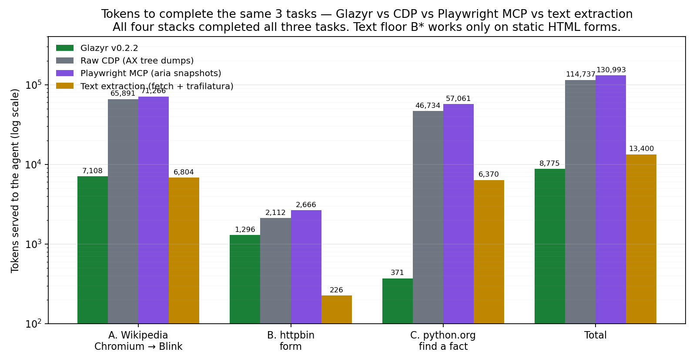

# Glazyr vs the field — benchmark comparison (Nov 21, 2026)

Same three tasks, four stacks, one scoreboard. Every stack ran the
dogfood flows end-to-end on the same machine (WSL, Will's PC), cold
start per stack, counting **every token served to the agent** to
complete the task (tiktoken cl100k_base). All four stacks completed
all three tasks.

## Tasks

- **A.** Wikipedia: Chromium article → report license + headings,
  click through to Blink, summarize it.
- **B.** httpbin form: type name + email, select Medium, check Bacon,
  submit, verify all four values in the server echo.
- **C.** python.org/downloads: find the latest release (3.15.2).

## Results — tokens to complete

| Flow | Glazyr v0.2.2 | Raw CDP | Playwright MCP | Text extraction |
|---|---|---|---|---|
| A. Wikipedia → Blink | **7,108** | 65,891 | 71,266 | 6,804 |
| B. httpbin form | **1,296** | 2,112 | 2,666 | 226 * |
| C. python.org fact | **371** | 46,734 | 57,061 | 6,370 |
| **Total** | **8,775** | **114,737** | **130,993** | **13,400** |

Glazyr uses **13× fewer tokens than raw CDP** and **15× fewer than
Playwright MCP** across the suite.

## How each stack reads a page

- **Glazyr** — shared-memory semantic tree + curation: summary-first
  navigate (245 tokens for Wikipedia), find/subtree zoom, sibling
  collapse, unchanged-state stubs, compact acks with inline deltas.
- **Raw CDP** — `Accessibility.getFullAXTree` dumped whole on every
  read (the naive LLM-to-DevTools wiring). One Wikipedia dump ≈ 56K
  tokens; two dumps per research flow.
- **Playwright MCP** (Microsoft `@playwright/mcp`, current version) —
  aria snapshot YAML on every read: the Chromium snapshot alone was
  219K characters. Action acks are tiny (it links snapshot files
  instead of inlining them), but every state read pays full price.
- **Text extraction** — fetch + trafilatura, no browser. Genuinely
  good at pure reading: it *wins* flow A by a hair (6,804 vs 7,108 —
  two article extractions vs Glazyr's summary + find + one full
  peek). It has no zoom, though: on flow C it pays 6,370 for the
  whole downloads page where Glazyr's summary + find pays 371
  (**17×**). And it cannot act in general — flow B only worked
  because httpbin's form is static HTML with a plain POST (*).
  Against any JS-driven page, a login, or a click, it scores zero.

## The honest summary

- On read-and-act work (what agents actually do), the gap is
  architectural: CDP and Playwright both re-serve the entire tree on
  every read; Glazyr serves a map first and zooms on demand.
- Extraction is the right floor for static reading and the wrong
  tool for interaction. Glazyr roughly ties it on article reading
  and beats it 17× the moment the agent needs one fact from a big
  page — before counting that Glazyr can also click and type.
- Read latency (measured Nov 21, spike): Glazyr semantic payload
  p50 0.9–43µs from shared memory vs CDP sidecar p50 38.7ms and
  1,521ms for a full AX pull on Wikipedia.

## Method notes (so the numbers can be trusted)

- Drivers: [`drivers/`](drivers/) in this folder —
  `benchmark_v022.py` (Glazyr), `cdp_bench.py`, `pw_bench.py`,
  `text_bench.py`. CDP used the same Chromium 158 binary as Glazyr,
  minus the producer flag — plain DevTools.
- Success checks verify outcomes, not page text presence: the Blink
  click must land on the Blink URL; the form check reads the server
  echo; the python.org check finds 3.15.2.
- Three harness bugs were found and fixed during the runs (a stale
  Playwright argument name, frame-prefixed snapshot refs, and a
  Wikipedia href-attribute selector) — each initially produced a
  failure that was the harness's fault, not the stack's. Final
  numbers are from clean, fully verified runs.
- Wall-clock per flow was seconds for every stack (network-bound);
  tokens are the differentiator, so they're the headline.
